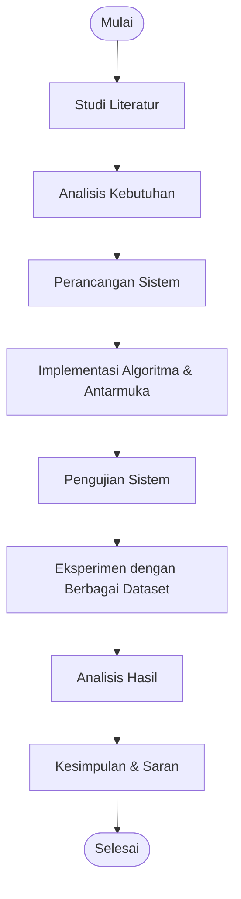

# Analisis Kombinasi Metode Konstruksi dan Perbaikan pada Travelling Salesman Problem (TSP)
 
Aplikasi web interaktif untuk mengimplementasikan, memvisualisasikan, dan membandingkan berbagai kombinasi **metode konstruksi** (*constructive heuristic*) dan **metode perbaikan** (*local search* / metaheuristik) pada Travelling Salesman Problem.
 
| | Metode |
|---|---|
| **Konstruksi** | Nearest Neighbor, Nearest Insertion, Farthest Neighbor, Arbitrary Solution |
| **Perbaikan** | 2-opt, Tabu Search, Simulated Annealing |
 
## Daftar Isi
 
- [Bab 1: Pendahuluan](#bab-1-pendahuluan)
- [Bab 2: Tinjauan Pustaka](#bab-2-tinjauan-pustaka)
- [Bab 3: Analisis, Perancangan, dan Implementasi Sistem](#bab-3-analisis-perancangan-dan-implementasi-sistem)
- [Bab 4: Hasil dan Pembahasan](#bab-4-hasil-dan-pembahasan)
- [Bab 5: Kesimpulan dan Saran](#bab-5-kesimpulan-dan-saran)
- [Daftar Pustaka](#daftar-pustaka)
---
 
## Bab 1: Pendahuluan
 
### 1.1 Latar Belakang
 
Travelling Salesman Problem (TSP) merupakan salah satu permasalahan optimasi kombinatorial yang paling klasik dan banyak dipelajari dalam bidang ilmu komputer dan riset operasi. Permasalahan ini bertujuan untuk menemukan rute terpendek yang mengunjungi setiap kota tepat satu kali dan kembali ke kota asal. Meskipun formulasi masalahnya sederhana, TSP tergolong ke dalam permasalahan **NP-Hard**, yang berarti tidak ada algoritma yang dapat menyelesaikan permasalahan ini dalam waktu polinomial untuk ukuran input yang besar.
 
TSP memiliki banyak aplikasi praktis dalam kehidupan sehari-hari, seperti perencanaan rute pengiriman barang, optimasi jalur distribusi, penjadwalan kunjungan sales, perencanaan rute wisata, dan lain sebagainya. Dalam konteks logistik dan distribusi, efisiensi rute sangat berpengaruh terhadap biaya operasional, waktu tempuh, dan konsumsi bahan bakar. Oleh karena itu, diperlukan metode yang mampu menghasilkan solusi mendekati optimal dalam waktu komputasi yang wajar.
 
Secara umum, pendekatan penyelesaian TSP dibagi menjadi dua kategori utama, yaitu metode eksak dan metode heuristic/metaheuristik. Metode eksak seperti Branch and Bound dan Dynamic Programming mampu menghasilkan solusi optimal, namun tidak praktis untuk jumlah kota yang besar karena kompleksitas waktunya yang eksponensial. Oleh karena itu, metode heuristic dan metaheuristik menjadi pilihan yang lebih realistis untuk permasalahan berskala besar.
 
Metode heuristic konstruktif seperti Nearest Neighbor, Nearest Insertion, Farthest Neighbor, dan Arbitrary Solution digunakan untuk membangun solusi awal dengan cepat. Solusi awal ini kemudian diperbaiki menggunakan metode perbaikan seperti 2-opt serta metaheuristik seperti Tabu Search dan Simulated Annealing. Kombinasi antara metode konstruksi dan metode perbaikan diharapkan mampu menghasilkan solusi yang berkualitas dengan waktu komputasi yang efisien.
 
Berdasarkan latar belakang tersebut, penelitian ini bertujuan untuk mengimplementasikan dan menganalisis kinerja berbagai kombinasi metode konstruksi dan metode perbaikan dalam menyelesaikan permasalahan TSP. Sistem diimplementasikan dalam bentuk aplikasi berbasis web agar dapat digunakan secara interaktif, dengan visualisasi langkah-langkah algoritma dan perbandingan hasil antar metode.
 
### 1.2 Rumusan Masalah
 
1. Bagaimana mengimplementasikan algoritma konstruksi Nearest Neighbor, Nearest Insertion, Farthest Neighbor, dan Arbitrary Solution dalam menyelesaikan permasalahan TSP?
2. Bagaimana mengimplementasikan metode perbaikan 2-opt, Tabu Search, dan Simulated Annealing untuk meningkatkan kualitas solusi awal?
3. Bagaimana perbandingan kualitas solusi dan waktu komputasi antara berbagai kombinasi metode konstruksi dan metode perbaikan pada dataset dengan ukuran yang berbeda?
4. Bagaimana pengaruh kualitas solusi awal terhadap hasil akhir yang diperoleh setelah proses perbaikan?
5. Bagaimana merancang aplikasi berbasis web yang mampu memvisualisasikan proses optimasi rute TSP secara bertahap?
### 1.3 Tujuan Penelitian
 
1. Mengimplementasikan empat metode konstruksi, yaitu Nearest Neighbor, Nearest Insertion, Farthest Neighbor, dan Arbitrary Solution untuk membangun solusi awal TSP.
2. Mengimplementasikan tiga metode perbaikan, yaitu 2-opt, Tabu Search, dan Simulated Annealing untuk memperbaiki solusi awal.
3. Membandingkan kinerja setiap kombinasi metode berdasarkan kualitas solusi (biaya rute) dan waktu komputasi.
4. Menganalisis pengaruh solusi awal terhadap kualitas solusi akhir yang dihasilkan.
5. Membangun aplikasi berbasis web yang dapat memvisualisasikan proses optimasi TSP secara interaktif dan menyajikan hasil perbandingan antar metode.
### 1.4 Batasan Masalah
 
1. Permasalahan TSP yang diselesaikan adalah TSP simetris pada bidang dua dimensi (koordinat kartesian).
2. Jarak antar titik dihitung menggunakan rumus jarak Euclidean.
3. Data yang digunakan terdiri dari data bawaan sistem (5 kota) serta data koordinat acak berukuran 25, 50, dan 100 titik.
4. Metode konstruksi yang digunakan terbatas pada Nearest Neighbor, Nearest Insertion, Farthest Neighbor, dan Arbitrary Solution.
5. Metode perbaikan yang digunakan terbatas pada 2-opt, Tabu Search, dan Simulated Annealing.
6. Parameter algoritma metaheuristik ditetapkan secara tetap sesuai dengan rancangan eksperimen.
7. Aplikasi diimplementasikan sebagai aplikasi berbasis web dan tidak membahas aspek keamanan serta skalabilitas sistem secara mendalam.
---
 
## Bab 2: Tinjauan Pustaka
 
### 2.1 Travelling Salesman Problem (TSP)
 
TSP adalah permasalahan optimasi kombinatorial yang bertujuan untuk menemukan rute terpendek yang mengunjungi sekumpulan kota tepat satu kali dan kembali ke kota awal. Secara formal, diberikan himpunan kota $V = \{v_1, v_2, \dots, v_n\}$ dan matriks jarak $D = [d_{ij}]$ yang menyatakan jarak antara kota $i$ dan kota $j$. TSP bertujuan untuk menemukan permutasi $\pi$ dari kota-kota tersebut yang meminimalkan total jarak:
 
$$f(\pi) = \sum_{i=1}^{n-1} d_{\pi(i),\pi(i+1)} + d_{\pi(n),\pi(1)}$$
 
TSP tergolong sebagai permasalahan NP-Hard, yang berarti kompleksitas waktunya tumbuh secara eksponensial seiring bertambahnya jumlah kota. Untuk $n$ kota, terdapat $(n-1)!/2$ kemungkinan rute yang berbeda pada TSP simetris. Oleh karena itu, pendekatan eksak hanya praktis untuk jumlah kota yang relatif kecil, sehingga pendekatan heuristic dan metaheuristik menjadi alternatif yang banyak digunakan.
 
### 2.2 TSP Simetris dan Asimetris
 
1. **TSP Simetris**: jarak antara kota $i$ dan kota $j$ sama dengan jarak antara kota $j$ dan kota $i$ ($d_{ij} = d_{ji}$). Rute dan rute kebalikannya memiliki biaya yang sama.
2. **TSP Asimetris**: jarak dari kota $i$ ke kota $j$ tidak sama dengan jarak dari kota $j$ ke kota $i$ ($d_{ij} \neq d_{ji}$). Umumnya terjadi pada jaringan jalan satu arah atau kondisi lalu lintas yang berbeda.
Pada penelitian ini, TSP yang diselesaikan adalah TSP simetris dengan jarak antar titik dihitung menggunakan rumus jarak Euclidean pada bidang dua dimensi.
 
### 2.3 Jarak Euclidean
 
Jarak Euclidean antara dua titik $i$ dan $j$ dengan koordinat $(x_i, y_i)$ dan $(x_j, y_j)$ dihitung menggunakan rumus:
 
$$d(i,j) = \sqrt{(x_i - x_j)^2 + (y_i - y_j)^2}$$
 
Rumus ini digunakan untuk membentuk matriks jarak yang menjadi dasar perhitungan biaya rute pada sistem yang dibangun.
 
### 2.4 Metode Konstruktif (*Constructive Heuristic*)
 
Metode konstruktif adalah pendekatan heuristic yang membangun solusi secara bertahap dari kondisi awal kosong hingga terbentuk rute lengkap. Metode ini umumnya cepat dan sederhana, tetapi kualitas solusi yang dihasilkan belum tentu mendekati optimal. Solusi yang dihasilkan biasanya digunakan sebagai solusi awal untuk diperbaiki oleh metode lain.
 
#### 2.4.1 Nearest Neighbor
 
Nearest Neighbor (NN) adalah algoritma konstruktif yang paling sederhana. Algoritma ini dimulai dari sebuah titik awal, kemudian secara berulang memilih titik yang belum dikunjungi dengan jarak terdekat dari titik terakhir. Proses ini berlanjut hingga semua titik telah dikunjungi, kemudian rute ditutup dengan kembali ke titik awal.
 
Kelebihan NN adalah kesederhanaan dan kecepatan komputasinya, yaitu $O(n^2)$. Namun, kelemahannya adalah solusi yang dihasilkan sangat bergantung pada pemilihan titik awal dan sering kali terjebak pada solusi yang jauh dari optimal.
 
#### 2.4.2 Nearest Insertion
 
Nearest Insertion (NI) dimulai dengan membentuk sub-tour dari dua titik, yaitu titik awal dan titik terdekatnya. Pada setiap iterasi, algoritma memilih titik yang belum dikunjungi yang paling dekat dengan sub-tour yang telah terbentuk, kemudian menyisipkannya pada posisi yang menghasilkan kenaikan biaya terkecil.
 
Kenaikan biaya penyisipan titik $v$ di antara titik $a$ dan $b$ dihitung dengan:
 
$$\Delta = d(a,v) + d(v,b) - d(a,b)$$
 
Algoritma ini umumnya menghasilkan solusi awal yang lebih baik dibandingkan Nearest Neighbor, dengan kompleksitas waktu $O(n^2)$.
 
#### 2.4.3 Farthest Neighbor
 
Farthest Neighbor (FN) memiliki mekanisme yang mirip dengan Nearest Neighbor, namun pada setiap langkah algoritma memilih titik yang belum dikunjungi dengan jarak **terjauh** dari titik terakhir. Pendekatan ini bertujuan untuk menyebarkan kunjungan secara merata, meskipun secara umum menghasilkan solusi awal dengan biaya yang lebih tinggi dibandingkan Nearest Neighbor dan Nearest Insertion.
 
#### 2.4.4 Arbitrary Solution
 
Arbitrary Solution membentuk solusi awal dengan mengacak urutan seluruh titik menggunakan *pseudo-random number generator* (PRNG). Untuk mendukung reprodusibilitas eksperimen, ditetapkan sebuah *seed* sehingga urutan acak yang dihasilkan dapat direproduksi. Metode ini umumnya menghasilkan solusi awal dengan biaya tertinggi, namun berguna sebagai pembanding untuk menguji efektivitas metode perbaikan.
 
### 2.5 Metode Local Search
 
Metode perbaikan lokal bekerja dengan melakukan modifikasi terhadap solusi awal secara iteratif untuk mencari solusi yang lebih baik di lingkungannya. Metode ini berhenti ketika tidak ada lagi perbaikan yang dapat dilakukan atau ketika batas iterasi tercapai.
 
#### 2.5.1 2-opt
 
2-opt menghapus dua sisi dari rute, kemudian menghubungkan kembali kedua bagian rute dengan membalik urutan titik pada segmen yang dipilih. Jika perubahan tersebut menghasilkan biaya yang lebih kecil, maka swap diterima.
 
Jika rute memiliki sisi $(a,b)$ dan $(c,d)$, maka 2-opt menggantinya dengan sisi $(a,c)$ dan $(b,d)$, dengan segmen antara $b$ dan $c$ dibalik urutannya. Perubahan biaya dihitung dengan:
 
$$\Delta = d(a,c) + d(b,d) - d(a,b) - d(c,d)$$
 
Proses diulang hingga tidak ada lagi perbaikan yang dapat dilakukan atau jumlah pass maksimum tercapai. 2-opt memiliki kompleksitas waktu $O(n^2)$ per iterasi dan merupakan metode perbaikan yang efisien untuk TSP.
 
### 2.6 Metaheuristik
 
Metaheuristik adalah metode optimasi tingkat tinggi yang dirancang untuk menjelajahi ruang solusi secara lebih luas, termasuk kemampuan untuk keluar dari optimum lokal. Berbeda dengan metode perbaikan lokal yang hanya menerima perbaikan, metaheuristik dapat menerima solusi yang lebih buruk dengan aturan tertentu.
 
#### 2.6.1 Tabu Search
 
Tabu Search (TS) adalah metaheuristik yang dikembangkan oleh Glover pada tahun 1989. TS memanfaatkan lingkungan solusi 2-opt, namun pada setiap iterasi algoritma memilih kandidat terbaik yang tidak memiliki status tabu. Status tabu diberikan kepada perpindahan yang baru saja dilakukan untuk mencegah terjadinya siklus dan mendorong eksplorasi ke daerah solusi yang belum dikunjungi.
 
*Tabu list* menggunakan mekanisme FIFO (*First In First Out*), di mana algoritma menyimpan pasangan titik yang berhasil melakukan swap. Perpindahan yang bersifat tabu dapat diterima jika menghasilkan solusi yang lebih baik daripada solusi terbaik global yang pernah ditemukan (*aspiration criteria*). Parameter yang dapat dikonfigurasi pada TS adalah jumlah iterasi dan *tabu tenure* (lama status tabu).
 
#### 2.6.2 Simulated Annealing
 
Simulated Annealing (SA) adalah metaheuristik yang terinspirasi dari proses *annealing* pada metalurgi, yaitu proses pemanasan dan pendinginan logam secara perlahan untuk mengurangi cacat kristal. SA memilih kandidat 2-opt secara acak. Solusi yang menurunkan biaya selalu diterima, sedangkan solusi yang menaikkan biaya diterima dengan probabilitas:
 
$$P(\text{terima}) = e^{-\Delta / T}$$
 
dengan $\Delta$ adalah kenaikan biaya dan $T$ adalah temperatur saat ini. Temperatur diperbarui secara bertahap menggunakan rumus:
 
$$T_{baru} = T_{lama} \times \alpha$$
 
dengan $\alpha$ adalah *cooling rate* ($0 < \alpha < 1$). Parameter yang dapat dikonfigurasi pada SA meliputi temperatur awal, temperatur minimum, *cooling rate*, dan jumlah iterasi untuk setiap tingkat temperatur.
 
### 2.7 Pengukuran Kinerja
 
1. **Biaya Rute (Cost)**: total jarak yang ditempuh pada rute yang dihasilkan. Semakin kecil biaya, semakin baik kualitas solusi.
2. **Persentase Perbaikan**: seberapa besar penurunan biaya dari solusi awal ke solusi akhir:
   $$\text{Perbaikan} = \frac{f_{awal} - f_{akhir}}{f_{awal}} \times 100\%$$
3. **Waktu Komputasi**: waktu yang dibutuhkan algoritma untuk menyelesaikan proses optimasi, diukur dalam milidetik (ms).
### 2.8 Teknologi yang Digunakan
 
Sistem diimplementasikan sebagai aplikasi berbasis web dengan teknologi pada [Bab 3.2](#32-teknologi-implementasi).
 
### 2.9 Penelitian Terdahulu
 
1. **Johnson dan McGeoch (1997)** melakukan studi komparatif terhadap berbagai metode heuristic dan metaheuristik untuk TSP, termasuk Nearest Neighbor, 2-opt, dan Simulated Annealing. Hasil penelitian menunjukkan bahwa kombinasi solusi awal yang baik dengan metode perbaikan lokal memberikan hasil yang mendekati optimal.
2. **Glover (1989)** memperkenalkan Tabu Search sebagai metaheuristik yang mampu mengatasi keterbatasan metode perbaikan lokal dengan mekanisme tabu list dan aspiration criteria.
3. **Kirkpatrick et al. (1983)** memperkenalkan Simulated Annealing sebagai metode optimasi yang terinspirasi dari proses annealing, dengan kemampuan menerima solusi yang lebih buruk untuk keluar dari optimum lokal.
4. **Croes (1958)** memperkenalkan algoritma 2-opt sebagai metode perbaikan lokal yang efektif untuk TSP, yang hingga kini masih banyak digunakan sebagai dasar metode perbaikan lainnya.
Penelitian ini melengkapi kajian tersebut dengan mengimplementasikan berbagai kombinasi metode konstruksi dan perbaikan dalam satu aplikasi berbasis web yang interaktif, serta menganalisis pengaruh solusi awal terhadap kualitas solusi akhir secara sistematis.
 
---
 
## Bab 3: Analisis, Perancangan, dan Implementasi Sistem
 
### 3.1 Metodologi Penelitian
 
Penelitian ini menggunakan pendekatan eksperimental dengan tahapan:
 
1. **Studi Literatur**: mengkaji teori terkait TSP, metode heuristic konstruktif, metode perbaikan lokal, metaheuristik, serta teknologi web yang digunakan.
2. **Perancangan Sistem**: merancang arsitektur sistem, alur proses, struktur data, serta antarmuka pengguna.
3. **Implementasi**: mengimplementasikan algoritma dan antarmuka sistem menggunakan teknologi yang telah ditentukan.
4. **Pengujian**: menguji fungsionalitas sistem dan memvalidasi hasil algoritma terhadap notebook Python sebagai referensi.
5. **Eksperimen**: menjalankan eksperimen dengan berbagai ukuran dataset dan kombinasi metode, kemudian menganalisis hasilnya.
6. **Analisis dan Kesimpulan**: menganalisis hasil eksperimen dan menarik kesimpulan berdasarkan data yang diperoleh.

 
### 3.2 Teknologi Implementasi
 
Sistem diimplementasikan sebagai aplikasi berbasis web:
 
- **React 19**: library JavaScript untuk antarmuka utama.
- **Vite 6**: *build tool* dari pembuatan awal aplikasi hingga produk akhir.
- **JavaScript**: seluruh perhitungan algoritma dijalankan di sisi klien.
- **read-excel-file**: library untuk membaca data dari file `.xlsx`.
- **Notebook Python**: menjadi dasar/panduan awal implementasi setiap algoritma dan pembanding hasil.
Simulasi terjadi pada bidang dua dimensi (koordinat kartesian). Setiap tempat direpresentasikan sebagai titik $(x, y)$, dan jarak dihitung dengan rumus Euclidean pada [Bab 2.3](#23-jarak-euclidean).
 
### 3.3 Arsitektur Sistem
 
Arsitektur sistem dibagi menjadi tiga lapisan utama:
 
1. **Lapisan Input Data dan Konfigurasi**
   - Menerima data tempat yang per barisnya mengandung nama tempat dan koordinat (x, y).
   - Menerima konfigurasi awal yang terdiri dari metode konstruksi, metode perbaikan, dan parameter algoritma.
2. **Lapisan Proses Data**
   - Memvalidasi data dan membentuk matriks jarak berdasarkan koordinat titik.
   - Menghasilkan solusi awal menggunakan metode konstruksi, lalu memperbaikinya dengan 2-opt, Tabu Search, atau Simulated Annealing.
   - Menyimpan setiap langkah algoritma dalam frame simulasi.
3. **Lapisan Output Hasil**
   - Menampilkan rute optimal, biaya awal dan akhir, persentase perbaikan, waktu komputasi, grafik perkembangan biaya, pseudocode, dan tabel perbandingan hasil eksekusi.
 
Alur utama sistem:
 

 
### 3.4 Perancangan Struktur Data
 
1. **Titik (Node)**: merepresentasikan sebuah tempat dengan atribut nama, koordinat x, dan koordinat y.
2. **Matriks Jarak**: matriks dua dimensi berukuran $n \times n$ yang menyimpan jarak Euclidean antar setiap pasangan titik.
3. **Rute (Tour)**: array yang menyimpan urutan indeks titik yang dikunjungi.
4. **Frame Simulasi**: objek yang menyimpan informasi langkah algoritma, meliputi fase proses, rute, biaya, biaya terbaik, metrik iterasi, dan baris pseudocode yang aktif.
5. **Tabu List**: struktur FIFO yang menyimpan pasangan titik yang baru saja melakukan swap pada Tabu Search.
6. **State Simulated Annealing**: menyimpan temperatur saat ini, temperatur minimum, cooling rate, dan iterasi per temperatur.
### 3.5 Perancangan dan Implementasi Algoritma
 
Landasan teori dan rumus setiap algoritma dibahas pada [Bab 2](#bab-2-tinjauan-pustaka). Bagian ini memuat pseudocode rancangan beserta catatan implementasi pada sistem.
 
#### 3.5.1 Nearest Neighbor
 
```text
function nearestNeighbor(nodes, start):
    tour = [start]
    unvisited = semua node kecuali start
    current = start
    while unvisited tidak kosong:
        next = node di unvisited dengan jarak terkecil dari current
        tour.append(next)
        unvisited.remove(next)
        current = next
    return tour
```
 
Hasil Nearest Neighbor sangat bergantung pada titik awal yang dipilih pengguna. Implementasinya sangat cepat dan sederhana, tetapi sulit mencapai global optimum, sehingga biasa digunakan sebagai solusi awal yang diperbaiki oleh algoritma lain.
 
#### 3.5.2 Nearest Insertion
 
```text
function nearestInsertion(nodes, start):
    tour = [start, node terdekat dari start]
    unvisited = semua node kecuali start dan node terdekat
    while unvisited tidak kosong:
        v = node di unvisited yang paling dekat dengan sub-tour
        posisi = posisi penyisipan v yang menghasilkan Δ terkecil
        tour.insert(posisi, v)
        unvisited.remove(v)
    return tour
```
 
Kenaikan biaya $\Delta$ dihitung dengan rumus penyisipan pada [Bab 2.4.2](#242-nearest-insertion), dengan $a$ dan $b$ sebagai ujung sisi dan $v$ sebagai titik kandidat baru.
 
#### 3.5.3 Farthest Neighbor
 
```text
function farthestNeighbor(nodes, start):
    tour = [start]
    unvisited = semua node kecuali start
    current = start
    while unvisited tidak kosong:
        next = node di unvisited dengan jarak terjauh dari current
        tour.append(next)
        unvisited.remove(next)
        current = next
    return tour
```
 
Mekanismenya sama dengan Nearest Neighbor, hanya kriteria pemilihan titik diganti menjadi yang terjauh dari titik terakhir.
 
#### 3.5.4 Arbitrary Solution
 
```text
function arbitrarySolution(nodes, seed):
    random = PRNG(seed)
    tour = salinan nodes
    shuffle(tour, random)
    return tour
```
 
Seed yang tetap (42) membuat urutan acak dapat direproduksi, sehingga percobaan yang sama menghasilkan rute yang sama.
 
#### 3.5.5 2-opt
 
```text
function twoOpt(tour, maxPass):
    pass = 0
    improved = true
    while improved dan pass < maxPass:
        improved = false
        for i dari 1 sampai n-1:
            for j dari i+1 sampai n:
                Δ = hitung perubahan biaya 2-opt
                if Δ < 0:
                    balik segmen tour[i..j]
                    improved = true
        pass = pass + 1
    return tour
```
 
Proses berhenti ketika seluruh kandidat telah dicoba tanpa ada $\Delta < 0$, atau ketika jumlah pass maksimum tercapai.
 
#### 3.5.6 Tabu Search
 
```text
function tabuSearch(tour, maxIter, tabuTenure):
    best = salinan tour
    tabuList = []
    for iter dari 1 sampai maxIter:
        kandidat terbaik = null
        for setiap kandidat 2-opt:
            if kandidat tidak tabu atau memenuhi aspiration criteria:
                if kandidat terbaik null atau biaya kandidat < biaya kandidat terbaik:
                    kandidat terbaik = kandidat
        if kandidat terbaik tidak null:
            terapkan kandidat terbaik
            tambahkan pasangan titik ke tabuList
            if panjang tabuList > tabuTenure:
                hapus elemen tertua
            if biaya tour < biaya best:
                best = salinan tour
    return best
```
 
Berbeda dengan 2-opt, kandidat yang dipilih tidak harus menurunkan biaya, sehingga pencarian dapat keluar dari optimum lokal. Tabu list menggunakan mekanisme FIFO, dan perpindahan tabu tetap diterima bila menghasilkan biaya lebih kecil daripada solusi terbaik global (*aspiration criteria*). Parameter yang dapat dikonfigurasi: jumlah iterasi dan *tabu tenure*.
 
#### 3.5.7 Simulated Annealing
 
```text
function simulatedAnnealing(tour, T0, Tmin, alpha, iterPerT):
    T = T0
    best = salinan tour
    while T > Tmin:
        for i dari 1 sampai iterPerT:
            kandidat = pilih 2-opt secara acak
            Δ = biaya kandidat - biaya tour
            if Δ < 0 atau random() < exp(-Δ/T):
                terapkan kandidat
                if biaya tour < biaya best:
                    best = salinan tour
        T = T * alpha
    return best
```
 
Probabilitas penerimaan dan pembaruan temperatur mengikuti rumus pada [Bab 2.6.2](#262-simulated-annealing). Parameter yang dapat dikonfigurasi: temperatur awal, temperatur minimum, *cooling rate* ($\alpha$), dan iterasi untuk setiap tingkat temperatur.
 
### 3.6 Perancangan dan Implementasi Antarmuka
 
1. **Panel data**
   - Memilih sumber data (data bawaan, file `.xlsx`, atau data acak).
   - Mengelola titik data (menambah, menghapus, mengedit).
   - Menampilkan daftar titik data.
2. **Panel metode**
   - Memilih metode konstruksi, titik awal, dan metode perbaikan.
   - Mengatur parameter algoritma.
3. **Area utama**
   - Menampilkan titik dan rute yang dihasilkan pada bidang dua dimensi.
   - Menampilkan grafik perkembangan biaya (biaya saat ini dan biaya terbaik).
   - Menampilkan pseudocode yang tersinkronisasi dengan langkah algoritma.
4. **Kontrol visualisasi**
   - Tombol kembali ke langkah sebelumnya dan tombol pause/langkah.
   - Opsi menampilkan label dan menampilkan rute terbaik.
5. **Panel hasil**
   - Metode konstruksi dan perbaikan, biaya solusi awal dan akhir, persentase perbaikan, waktu komputasi, dan urutan rute akhir.
   - Tabel perbandingan beberapa eksekusi.
Setiap langkah algoritma disimpan dalam frame simulasi (lihat [Bab 3.4](#34-perancangan-struktur-data)) sehingga perubahan solusi dapat dilihat secara bertahap. Persentase perbaikan pada panel hasil dihitung dengan rumus pada [Bab 2.7](#27-pengukuran-kinerja).
 
### 3.7 Rancangan Eksperimen dan Metrik Evaluasi
 
#### 3.7.1 Rancangan Eksperimen
 
Eksperimen dilakukan dengan 4 jenis ukuran dataset:
 
1. 5 kota awal dari bawaan sistem.
2. 25 koordinat acak.
3. 50 koordinat acak.
4. 100 koordinat acak.
Untuk setiap ukuran data, digunakan empat metode konstruksi (Nearest Neighbor, Nearest Insertion, Farthest Neighbor, Arbitrary). Setiap solusi awal diperbaiki dengan 2-opt, Tabu Search, dan Simulated Annealing.
 
**Parameter eksperimen:**
 
| Parameter | Nilai |
|---|---|
| Maksimum pass 2-opt | 100 |
| Maksimum iterasi Tabu Search | 100 |
| Tabu tenure | 10 |
| Temperatur awal Simulated Annealing | 1000 |
| Temperatur minimum | 0,001 |
| Cooling rate | 0,995 |
| Iterasi per temperatur | 100 |
| Seed algoritma | 42 |
 
#### 3.7.2 Metrik Evaluasi
 
1. **Biaya Awal**: total jarak rute yang dihasilkan metode konstruksi sebelum perbaikan.
2. **Biaya Akhir**: total jarak rute setelah proses perbaikan.
3. **Persentase Perbaikan**: penurunan biaya dari solusi awal ke solusi akhir.
4. **Waktu Komputasi**: waktu menjalankan algoritma, dalam milidetik.
### 3.8 Pengujian Sistem
 
Pengujian dilakukan terhadap fungsi algoritma, validasi parameter, dan pembacaan data.
 
| No. | Skenario Pengujian | Hasil yang diharapkan | Hasil |
|---|---|---|---|
| 1 | Nearest Neighbor pada lima titik data kota | Rute dan biaya sama dengan hasil di notebook | ✅ Lulus |
| 2 | Tabu Search pada lima titik data kota | Biaya sama dengan hasil notebook | ✅ Lulus |
| 3 | Dua belas kombinasi metode konstruksi dan perbaikan pada 25 titik data kota | Rute merupakan permutasi yang valid dan tidak ada biaya akhir yang lebih buruk | ✅ Lulus |
| 4 | Kondisi berhenti 2-opt | 2-opt berhenti ketika tidak ada perubahan biaya (Δ) yang kurang dari 0 | ✅ Lulus |
| 5 | Reprodusibilitas Simulated Annealing | Seed yang sama menghasilkan rute dan jumlah langkah yang sama | ✅ Lulus |
| 6 | Sinkronisasi pseudocode | Pseudocode berjalan sesuai dengan tampilan hasil | ✅ Lulus |
| 7 | Validasi parameter | Parameter di luar rentang ditolak | ✅ Lulus |
| 8 | Parser data teks | Dapat membaca data tanpa header dan melompati baris yang tidak sesuai | ✅ Lulus |
| 9 | Parser koordinat geografis | Kolom lat/lng dikenali dan data kosong dilaporkan | ✅ Lulus |
 
Berdasarkan hasil di atas, sistem berjalan sesuai dengan rancangan sehingga mengurangi risiko terjadinya kegagalan sistem.
 
---
 
## Bab 4: Hasil dan Pembahasan
 
### 4.1 Rancangan Eksperimen
 
Eksperimen dibagi menjadi dua bagian, yaitu pengujian kombinasi metode konstruksi dan perbaikan, serta pengujian perubahan parameter metaheuristik. Pembagian ini dilakukan untuk mengetahui kemampuan setiap kombinasi metode, kemudian melihat pengaruh parameter Tabu Search dan Simulated Annealing secara terpisah.
 
#### 4.1.1 Pengujian Kombinasi Metode
 
Ukuran dataset, metode konstruksi, dan parameter eksperimen mengikuti [Bab 3.7](#37-rancangan-eksperimen-dan-metrik-evaluasi). Dataset yang sama digunakan untuk membandingkan setiap kombinasi, dengan keluaran berupa biaya akhir, persentase perbaikan, dan waktu komputasi.
 
Setiap solusi awal dari keempat metode konstruksi dilanjutkan dengan salah satu dari empat pilihan: tanpa perbaikan, 2-opt, Tabu Search, atau Simulated Annealing. Dengan demikian terdapat 16 kombinasi metode. Untuk ukuran 25, 50, dan 100 titik digunakan masing-masing 5 dataset acak, ditambah dataset 5 kota bawaan, sehingga total terdapat 256 pengujian (16 × (3 × 5 + 1)). Hasil per dataset dapat dilihat pada [Lampiran](#lampiran).
 
#### 4.1.2 Pengujian Perubahan Parameter Metaheuristik
 
Pengujian ini bertujuan mengetahui pengaruh parameter terhadap hasil Tabu Search dan Simulated Annealing. Pengujian dilakukan pada dataset 100 titik dengan Nearest Neighbor sebagai metode konstruksi dan titik 001 sebagai titik awal, dengan biaya awal sebesar 979,96. Pada setiap kelompok pengujian hanya satu parameter yang diubah, sedangkan parameter lainnya tetap. Variasi parameter yang digunakan:
 
| Metode | Parameter yang diubah | Nilai yang diuji | Parameter tetap |
|---|---|---|---|
| Tabu Search | Maksimum iterasi | 25, 50, 100, 200, 500 | Tabu tenure = 10 |
| Tabu Search | Tabu tenure | 3, 5, 10, 20, 30 | Maksimum iterasi = 100 |
| Simulated Annealing | Temperatur awal | 100, 500, 1.000, 2.000, 5.000 | Temperatur minimum = 0,001; cooling rate = 0,995; iterasi per temperatur = 100 |
| Simulated Annealing | Cooling rate | 0,900; 0,950; 0,980; 0,995; 0,999 | Temperatur awal = 1.000; temperatur minimum = 0,001; iterasi per temperatur = 100 |
| Simulated Annealing | Iterasi per temperatur | 25, 50, 100, 200, 500 | Temperatur awal = 1.000; temperatur minimum = 0,001; cooling rate = 0,995 |
 
Setiap kelompok memiliki 5 nilai parameter sehingga total terdapat 25 run. Bersama pengujian kombinasi metode, total run pada penelitian ini sebanyak 281.
 
Analisis didasarkan pada dua ukuran utama: biaya akhir untuk menilai kualitas rute, dan waktu komputasi untuk menilai biaya tambahan akibat perubahan parameter. Dengan cara ini dapat dilihat sensitivitas parameter terhadap dataset yang digunakan.
 
### 4.2 Hasil pada Data Lima Kota
 
Data bawaan terdiri dari Jakarta (0,0), Bandung (2,3), Yogyakarta (5,1), Surabaya (6,5), dan Malang (8,2). Biaya yang dihasilkan tiap metode konstruksi diikuti tiap metode perbaikan:
 
| Metode Konstruksi | Tanpa Perbaikan | 2-opt | Tabu Search | Simulated Annealing |
|---|---:|---:|---:|---:|
| Nearest Neighbor | 21,7892 | 19,9445 | 19,9445 | 19,9445 |
| Nearest Insertion | 19,9445 | 19,9445 | 19,9445 | 19,9445 |
| Farthest Neighbor | 28,0232 | 19,9445 | 19,9445 | 19,9445 |
| Arbitrary | 27,2964 | 19,9445 | 19,9445 | 19,9445 |
 
Nearest Insertion menghasilkan biaya terbaik tanpa perbaikan, dan seluruh metode perbaikan membawa semua solusi awal ke biaya yang sama (19,9445).
 
### 4.3 Perbandingan Solusi Awal
 
Rata-rata biaya solusi awal untuk masing-masing ukuran data:
 
| Jumlah Titik | Nearest Neighbor | Nearest Insertion | Farthest Neighbor | Arbitrary |
|---:|---:|---:|---:|---:|
| 25 | 513,45 | **490,56** | 1777,60 | 1333,99 |
| 50 | 707,33 | **691,46** | 3783,84 | 2746,93 |
| 100 | 999,63 | **957,81** | 7561,43 | 5212,46 |
 
Nearest Insertion menghasilkan solusi awal terbaik pada ketiga ukuran dataset. Nearest Neighbor berada di peringkat kedua dengan hasil yang cukup baik dari algoritma yang lebih sederhana. Farthest Neighbor menghasilkan solusi awal dengan biaya paling tinggi, diikuti Arbitrary yang mengambil rute secara acak tanpa memperhatikan kedekatan jarak.
 
### 4.4 Perbandingan Metode Perbaikan
 
| Jumlah Titik | Metode | Rata-rata biaya awal | Rata-rata biaya akhir | Rata-rata perbaikan | Rata-rata waktu |
|---:|---|---:|---:|---:|---:|
| 25 | 2-opt | 1028,9 | 430,12 | 42,92% | 0,17 ms |
| 25 | Tabu Search | 1028,9 | 422,15 | 43,77% | 1,8 ms |
| 25 | Simulated Annealing | 1028,9 | **418,09** | 44,29% | 34,95 ms |
| 50 | 2-opt | 1982,39 | 614,87 | 46,84% | 0,45 ms |
| 50 | Tabu Search | 1982,39 | **601,07** | 47,54% | 5,24 ms |
| 50 | Simulated Annealing | 1982,39 | 601,15 | 47,52% | 47,75 ms |
| 100 | 2-opt | 3682,83 | 858,41 | 49,38% | 2,1 ms |
| 100 | Tabu Search | 3682,83 | 850,79 | 49,87% | 22,49 ms |
| 100 | Simulated Annealing | 3682,83 | **828,46** | 50,91% | 77,6 ms |
 
Seluruh metode perbaikan mampu menurunkan biaya secara signifikan, termasuk pada solusi awal berbiaya tinggi dari Farthest Neighbor dan Arbitrary. Ini menunjukkan bahwa metode yang digunakan efektif untuk permasalahan ini.
 
- **2-opt** memiliki waktu komputasi paling baik dengan penurunan biaya yang besar. Kekurangannya dibanding Tabu Search dan Simulated Annealing: solusi berhenti pada optimum lokal.
- **Tabu Search** menghasilkan biaya lebih rendah daripada 2-opt pada semua ukuran data, dengan waktu komputasi sekitar 10–12 kali lebih tinggi.
- **Simulated Annealing** menghasilkan biaya terbaik pada 25 dan 100 titik. Pada 100 titik, rata-rata biayanya 828,46, lebih rendah 29,95 dibanding 2-opt dan 22,33 dibanding Tabu Search. Namun biaya komputasinya cukup besar karena banyaknya tingkat temperatur (sekitar 2757) dengan total iterasi sebanyak 275.700.
### 4.5 Pengaruh Solusi Awal
 
Kualitas metode konstruksi berpengaruh besar terhadap biaya sebelum perbaikan, dengan Nearest Insertion sebagai pilihan terbaik untuk solusi awal.
 
Walaupun solusi awal buruk, metode perbaikan (2-opt maupun metaheuristik) mampu membawa solusi awal yang buruk hingga mencapai solusi akhir yang baik dengan batas iterasi yang sama. Berdasarkan hasil tersebut:
 
- Jika fokus pada **penurunan biaya**: kombinasi Nearest Insertion dengan Tabu Search atau Simulated Annealing layak digunakan.
- Jika fokus pada **efisiensi komputasi**: Nearest Neighbor dengan 2-opt lebih cocok.
### 4.6 Pengaruh Perubahan Parameter Metaheuristik
 
Eksperimen tambahan ini menganalisis pengaruh parameter Tabu Search dan Simulated Annealing menggunakan konfigurasi pada [Bab 4.1.2](#412-pengujian-perubahan-parameter-metaheuristik): dataset 100 titik, Nearest Neighbor dari titik 001, dan biaya awal 979,96.
 
#### 4.6.1 Pengaruh Maksimum Iterasi Tabu Search
 
Pengujian dengan tabu tenure sebesar 10.
 
| Maksimum iterasi | Biaya akhir | Perbaikan | Waktu |
|---:|---:|---:|---:|
| 25 | 812,66 | 17,1% | 20 ms |
| 50 | 810,34 | 17,3% | 34 ms |
| 100 | 810,34 | 17,3% | 43 ms |
| 200 | 810,34 | 17,3% | 74 ms |
| 500 | 810,34 | 17,3% | 159 ms |
 
Peningkatan iterasi dari 25 ke 50 menurunkan biaya dari 812,66 menjadi 810,34. Penambahan iterasi dari 50 hingga 500 tidak menghasilkan solusi yang lebih baik, hanya menambah waktu komputasi dari 34 ms menjadi 159 ms.
 
#### 4.6.2 Pengaruh Tabu Tenure
 
Pengujian dengan maksimum iterasi sebesar 100.
 
| Tabu tenure | Biaya akhir | Perbaikan | Waktu |
|---:|---:|---:|---:|
| 3 | 810,34 | 17,3% | 36 ms |
| 5 | 810,34 | 17,3% | 27 ms |
| 10 | 810,34 | 17,3% | 34 ms |
| 20 | 803,29 | 18,0% | 58 ms |
| 30 | **796,91** | 18,7% | 64 ms |
 
Tabu tenure 3, 5, dan 10 menghasilkan biaya akhir yang sama, yaitu 810,34. Ketika tenure dinaikkan ke 20, biaya turun menjadi 803,29, dan biaya terendah dicapai pada tenure 30 sebesar 796,91.
 
Tenure yang lebih panjang mencegah algoritma mengulang pertukaran yang baru dilakukan untuk lebih banyak iterasi. Pada dataset ini, tenure 20 dan 30 membantu menemukan solusi yang lebih baik daripada tenure yang lebih pendek, namun waktu komputasi meningkat menjadi 58 ms dan 64 ms.
 
#### 4.6.3 Pengaruh Temperatur Awal Simulated Annealing
 
Pengujian dengan temperatur minimum 0,001, cooling rate 0,995, dan 100 iterasi per temperatur.
 
| Temperatur awal | Biaya akhir | Perbaikan | Waktu |
|---:|---:|---:|---:|
| 100 | 797,91 | 18,6% | 169 ms |
| 500 | 807,97 | 17,6% | 342 ms |
| 1.000 | 810,22 | 17,3% | 451 ms |
| 2.000 | 835,39 | 14,8% | 516 ms |
| 5.000 | **797,39** | 18,6% | 582 ms |
 
Perubahan temperatur awal tidak menghasilkan pola penurunan biaya yang berurutan. Temperatur awal 5.000 menghasilkan biaya terendah sebesar 797,39 dengan waktu 582 ms, sedangkan temperatur awal 100 menghasilkan biaya 797,91 dalam waktu 169 ms.
 
Selisih biaya antara kedua nilai tersebut hanya 0,52, sementara temperatur 5.000 membutuhkan waktu sekitar 3,4 kali lebih lama. Pada run ini, temperatur awal yang lebih tinggi tidak selalu menghasilkan biaya yang lebih rendah.
 
#### 4.6.4 Pengaruh Cooling Rate Simulated Annealing
 
Pengujian dengan temperatur awal 1.000, temperatur minimum 0,001, dan 100 iterasi per temperatur.
 
| Cooling rate | Biaya akhir | Perbaikan | Waktu |
|---:|---:|---:|---:|
| 0,900 | 936,86 | 4,4% | 25 ms |
| 0,950 | 875,73 | 10,6% | 63 ms |
| 0,980 | 891,90 | 9,0% | 111 ms |
| 0,995 | 810,22 | 17,3% | 417 ms |
| 0,999 | **791,66** | 19,2% | 2.018 ms |
 
Cooling rate 0,900 mendinginkan temperatur paling cepat dengan waktu komputasi hanya 25 ms, tetapi biaya akhirnya relatif tinggi (936,86). Cooling rate 0,999 menghasilkan biaya terendah (791,66) karena temperatur turun lebih lambat sehingga pencarian berlangsung lebih lama, yaitu 2.018 ms.
 
Peningkatan kualitas solusi disertai kenaikan waktu komputasi: cooling rate 0,999 membutuhkan waktu hampir lima kali lipat dibandingkan 0,995. Hasil cooling rate 0,980 juga lebih buruk daripada 0,950, sehingga hubungan antara parameter dan hasil tidak selalu monoton.
 
#### 4.6.5 Pengaruh Iterasi per Temperatur
 
Pengujian dengan temperatur awal 1.000, temperatur minimum 0,001, dan cooling rate 0,995.
 
| Iterasi per temperatur | Biaya akhir | Perbaikan | Waktu |
|---:|---:|---:|---:|
| 25 | 847,05 | 13,6% | 121 ms |
| 50 | 821,57 | 16,2% | 240 ms |
| 100 | 810,22 | 17,3% | 472 ms |
| 200 | 802,58 | 18,1% | 887 ms |
| 500 | **789,44** | 19,4% | 2.164 ms |
 
Biaya akhir turun seiring bertambahnya iterasi per temperatur, dari 847,05 pada 25 iterasi menjadi 789,44 pada 500 iterasi. Namun waktu komputasi ikut naik dari 121 ms menjadi 2.164 ms. Konfigurasi 500 iterasi menghasilkan biaya terendah, tetapi membutuhkan waktu paling lama.
 
#### 4.6.6 Perbandingan Hasil Parameter
 
Hasil terbaik Tabu Search diperoleh dengan maksimum 100 iterasi dan tabu tenure 30, dengan biaya akhir 796,91 dan waktu 64 ms. Hasil terbaik Simulated Annealing diperoleh dengan 500 iterasi per temperatur, dengan biaya akhir 789,44 dan waktu 2.164 ms.
 
Simulated Annealing menghasilkan biaya 7,47 lebih rendah daripada Tabu Search, tetapi membutuhkan waktu sekitar 33,8 kali lebih lama. Oleh karena itu, pemilihan parameter tidak dapat didasarkan pada biaya akhir saja, melainkan juga harus mempertimbangkan waktu yang diperlukan untuk mencari solusi.
 
---
 
## Bab 5: Kesimpulan dan Saran
 
### 5.1 Kesimpulan
 
1. Sistem berbasis web berhasil mengintegrasikan pemasukan data, pembentukan solusi awal, proses perbaikan, visualisasi langkah, dan perbandingan hasil simulasi TSP antar metode pada satu interface.
2. Metode konstruksi yang diimplementasikan: Nearest Neighbor, Nearest Insertion, Farthest Neighbor, dan Arbitrary. Metode perbaikan yang diimplementasikan: 2-opt, Tabu Search, dan Simulated Annealing.
3. Seluruh skenario pengujian berhasil dijalankan dan sistem tidak mengalami kegagalan.
4. Nearest Insertion menghasilkan solusi awal terbaik pada data acak 25, 50, dan 100 titik dengan biaya rata-rata 490,56; 691,46; dan 957,81. Pada data lima kota, Nearest Insertion juga menghasilkan biaya terendah tanpa perbaikan, yaitu 19,9445.
5. 2-opt menawarkan hasil yang efisien terhadap waktu komputasi dan juga memberikan solusi yang cukup baik.
6. Tabu Search unggul dalam penurunan biaya dibandingkan 2-opt dan Simulated Annealing tepatnya pada 50 titik, serta memiliki waktu komputasi lebih rendah daripada Simulated Annealing.
7. Simulated Annealing menghasilkan rata-rata biaya terbaik pada data 25 dan 100 titik, tetapi memerlukan waktu komputasi lebih besar dibandingkan 2-opt dan Tabu Search.
8. Perubahan parameter metaheuristik mempengaruhi kualitas solusi dan waktu komputasi. Hasil terbaik Tabu Search dicapai dengan tabu tenure 30 (biaya 796,91), sedangkan Simulated Annealing dengan 500 iterasi per temperatur (biaya 789,44).
9. Tidak ada metode yang unggul sekaligus dari sisi kualitas solusi dan waktu komputasi. Pemilihan metode dan parameter perlu mempertimbangkan ketersediaan sumber daya.
Secara keseluruhan, sistem berbasis web dapat menjalankan proses optimasi rute untuk TSP serta membandingkan hasil masing-masing algoritma disertai visualisasi grafik.
 
### 5.2 Saran
 
1. Menguji setiap konfigurasi dengan beberapa seed untuk memastikan stabilitas hasil.
2. Menambahkan nilai parameter pada tabel perbandingan eksekusi agar lebih mudah dicatat.
3. Menambahkan metode konstruksi lainnya seperti Cheapest Insertion, Farthest Insertion, atau Greedy Insertion, lalu menguji kombinasinya dengan metode metaheuristik pada dataset yang lebih beragam.
4. Menggunakan 3-opt sebagai dasar dari metode metaheuristik pada Tabu Search dan Simulated Annealing.
---
 
## Daftar Pustaka
 
> 🚧 *Belum diisi.* Rujukan yang disebut pada [Bab 2.9](#29-penelitian-terdahulu): Johnson & McGeoch (1997), Glover (1989), Kirkpatrick et al. (1983), Croes (1958).
 
---
